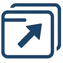

<picture>
  <source media="(prefers-color-scheme: dark)" srcset="icons/icon-white128.png">
  
</picture>

# Tab it

Keep the page you are on, and open new destinations in a new tab.

Tab it is a small Chrome extension (Manifest V3) that makes these navigations open in a new tab instead of replacing the current page:

1. Links that point to a different domain (subdomains count as the same domain)
2. URLs typed or pasted into the address bar, plus address-bar searches
3. Bookmarks
4. Items clicked on the `chrome://history` page

Each one is a checkbox on the options page. New tabs can also be opened in the background. The options page follows the browser or system light/dark theme, and so does the toolbar icon (blue on light themes, white on dark ones). Clicking the toolbar icon opens the options.

# Download and Install

Download the latest version from the [Releases](https://github.com/unalignedcoder/tabit/releases) page, or clone this repository, then:

1. Open `chrome://extensions` (`edge://extensions`, `brave://extensions`…) and turn on **Developer mode**.
2. Click **Load unpacked** and select the extension folder.
3. To change settings, open the extension's **Details** page and click **Extension options**.

It works in Chrome, Edge, Brave, Vivaldi and other Chromium browsers.

## How it works

- **External links (#1):** a content script intercepts link clicks before the browser navigates and opens the link in a new tab. This is clean: the current page never changes.
- **Address bar, bookmarks and history (#2–#4):** these navigations happen in the browser itself, outside any web page. The service worker spots them as they are committed, opens the URL in a new tab and sends the original tab back to where it was.

## Toolbar icon

Chrome gives extensions no way to read the toolbar color, and the service worker can't check the color scheme either. So the pages report it instead: the content script and the options page read `prefers-color-scheme` and tell the service worker when it changes, and the worker switches the icon with `chrome.action.setIcon`. This follows Chrome's *Mode* setting (light / dark / device). A custom Chrome theme that is dark while the mode is light still gets the blue icon.

## Limitations

**Chrome has no API that lets an extension stop or redirect an address-bar, bookmark or history navigation before it happens.** The only thing an extension can do is react once the navigation has started. So for options #2–#4, Tab it has to let the page **open in the same tab first, then go back**:

- The current tab briefly starts loading the new page, then goes back to the previous one, while the page opens in a new tab. You may see a short flicker.
- The site may receive one extra request (from the tab that went back).
- Because the tab really did navigate, the page you went back from may reload, and unsaved form input on it can be lost. Its back/forward history also gets the extra entry.
- When the current tab is an empty New Tab page there is nothing to go back to, so the navigation simply stays in that tab.

Other limitations:

- Content scripts don't run on `chrome://` pages or the Chrome Web Store, so #1 doesn't apply there.
- #1 only handles real `<a href>` clicks. It doesn't catch JavaScript navigations or form submissions.
- Ctrl-, Shift- and middle-clicks are left to the browser's normal handling.
- If address-bar navigations are sometimes missed, Chrome may have prerendered the page (*Settings → Performance → Preload pages*). Turn on **Debug logging** in the options and check the service worker console to see which transition types are reported.

## Project layout

```
manifest.json    extension manifest (MV3)
background.js    service worker: address bar, bookmarks, history (#2–#4), opens tabs for #1
content.js       intercepts clicks on links to other domains (#1)
options.html/js  options page
icons/           extension icons (blue for light themes, white for dark ones)
```

## Support

Tab it is free. If you find it useful, you can support its development:

<a href="https://buymeacoffee.com/unalignedcoder" target="_blank"></a>

## License

[MIT](LICENSE)
